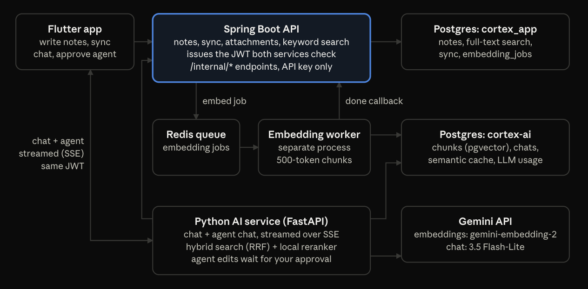

# cortex_app_be

The Spring Boot API behind [Cortex](https://github.com/abhishekpanja554/cortex), an offline-first notes app you can ask questions about.
It owns accounts, notes, image attachments, keyword search and the sync protocol that keeps every device's local database in step, with field-level conflict detection.
It never calls an LLM: when a note changes, it queues an embedding job in Redis for [cortex-ai](https://github.com/abhishekpanja554/cortex-ai) and tracks it until cortex-ai calls back.

A demo GIF of the app is in the [Cortex README](https://github.com/abhishekpanja554/cortex#readme).

## Architecture



| Repository | Role |
|---|---|
| [cortex](https://github.com/abhishekpanja554/cortex) | Flutter app: encrypted local database, sync engine, chat and agent UI |
| **cortex_app_be** (this repo) | Auth, notes, sync, attachments, keyword search, embedding jobs |
| [cortex-ai](https://github.com/abhishekpanja554/cortex-ai) | Embedding worker, hybrid search, reranking, RAG chat and agent |

## What's inside

- **Auth:** email and password login, short-lived JWT access tokens (15 min) and rotating refresh tokens (30 days). Reusing an old refresh token revokes its whole token family.
- **Notes:** CRUD with cursor pagination, soft deletes, and note reads cached in Redis.
- **Keyword search:** Postgres full-text search over a weighted `tsvector` (title ranks above body), with cursor pagination.
- **Sync:** the app pushes changed notes and pulls everything changed since its cursor. Title and body carry separate timestamps, so edits to different fields from two devices merge. A real conflict on the same field becomes a conflict copy the user resolves in the app.
- **Attachments:** idempotent `PUT /attachments/{uuid}` uploads, where the app picks the id. The type is checked from the file's first bytes, not the request header (JPEG, PNG, WebP, HEIC), with a 10 MB limit.
- **Embedding jobs:** every note change publishes a job to the Redis list `jobs:embedding` and records it in `embedding_jobs`. cortex-ai reports back through `/internal/jobs/{id}/complete` or `/fail`. A sweeper fails any job still pending after 5 minutes.
- **Internal API:** `/internal/*` endpoints, protected by a shared API key, give cortex-ai's agent search and note tools. Every query is scoped to the note's owner.
- **Observability:** JSON request logs with bodies (images are never logged) and Spring Boot Actuator health checks.

## API

| Method and path | Purpose |
|---|---|
| `POST /auth/register`, `/auth/login`, `/auth/refresh` | Accounts and tokens |
| `GET /notes`, `POST /notes`, `GET` / `PUT` / `DELETE /notes/{id}` | Notes |
| `GET /search?q=` | Keyword search |
| `POST /sync/push`, `GET /sync/pull` | Sync |
| `PUT` / `GET /attachments/{id}` | Image upload and download |
| `/internal/notes/*`, `/internal/search`, `/internal/jobs/*` | Used by cortex-ai only (API key) |

A Postman collection covering auth, notes, search and sync is in [`postman/`](postman/).

## Running it locally

You need JDK 26, PostgreSQL, and Docker for Redis.

```bash
createdb cortex_app

export JWT_SECRET=$(openssl rand -base64 48)        # at least 256 bits; cortex-ai needs the same value
export CORTEX_AI_API_KEY=$(openssl rand -hex 32)    # cortex-ai needs the same value
export DB_PASSWORD=<your postgres password>
# The datasource defaults to localhost:5432/cortex_app as user "abhis"; override it if yours differs:
export SPRING_DATASOURCE_USERNAME=<your postgres user>

./mvnw spring-boot:run
```

The API listens on port 8080.

- Flyway creates the schema on first start.
- With Docker running, Spring Boot starts Redis from `compose.yaml` for you. Otherwise run `docker compose up -d` first.
- The app refuses to start if `JWT_SECRET` is missing or shorter than 256 bits.
- Uploaded images are stored in `./data/attachments`. Set `ATTACHMENTS_DIR` to change that.
- Logs are JSON by default.

Check it's up:

```bash
curl http://localhost:8080/actuator/health
```

To get answers and embeddings, also run [cortex-ai](https://github.com/abhishekpanja554/cortex-ai#running-it-locally). Without it, notes, search and sync still work, and embedding jobs time out after 5 minutes.

### Tests

```bash
./mvnw test
```

## License

[Apache 2.0](LICENSE)
